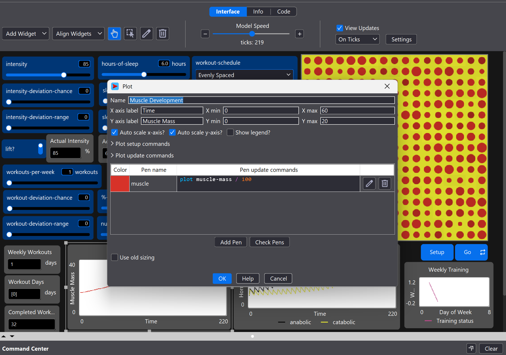
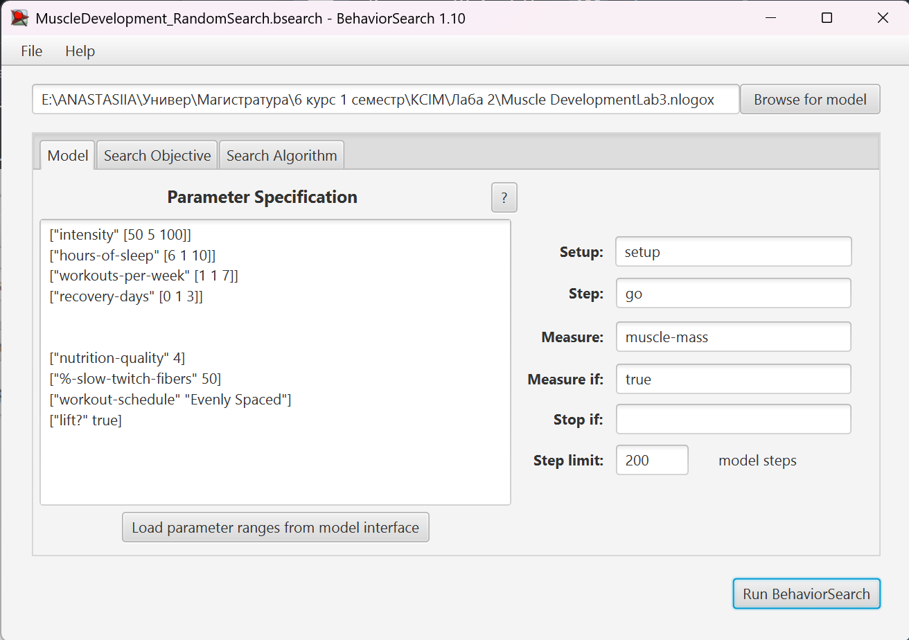
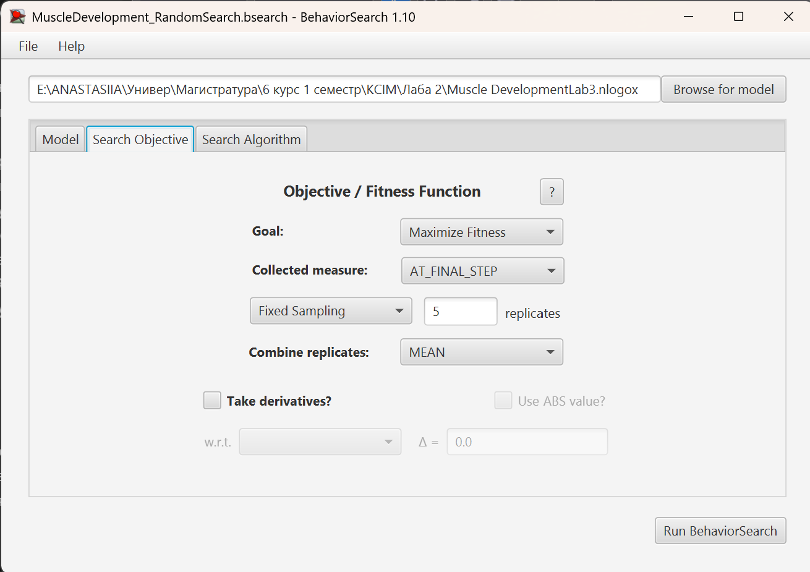
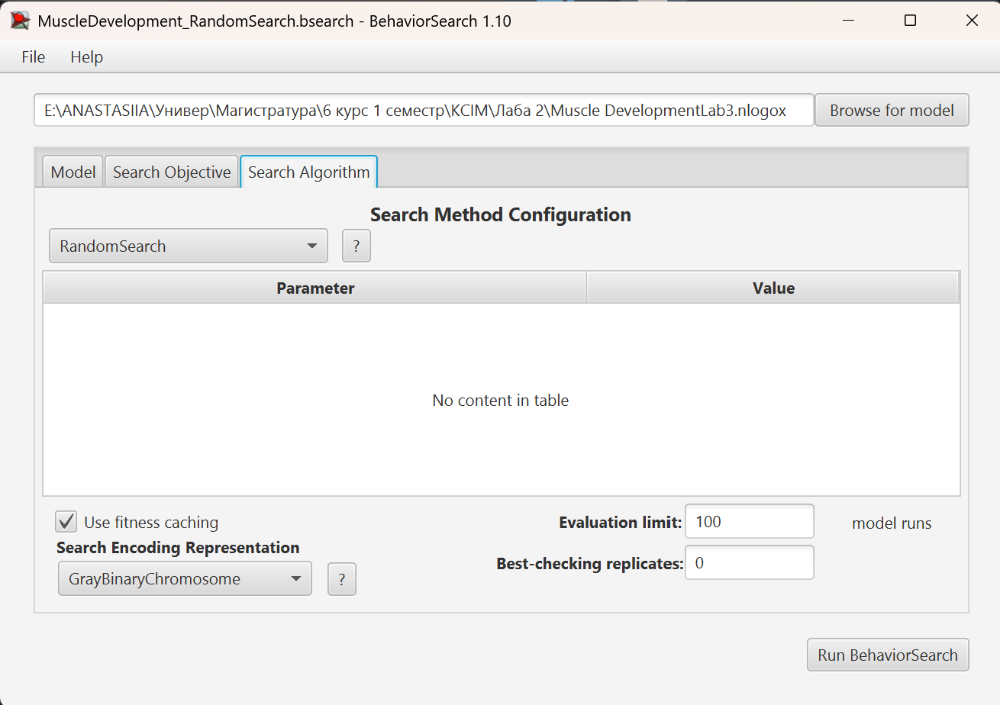
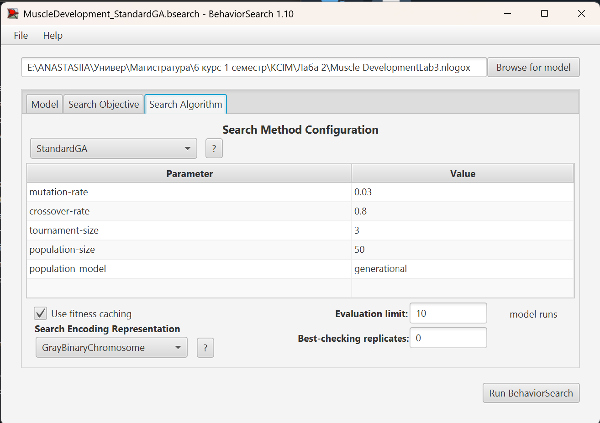
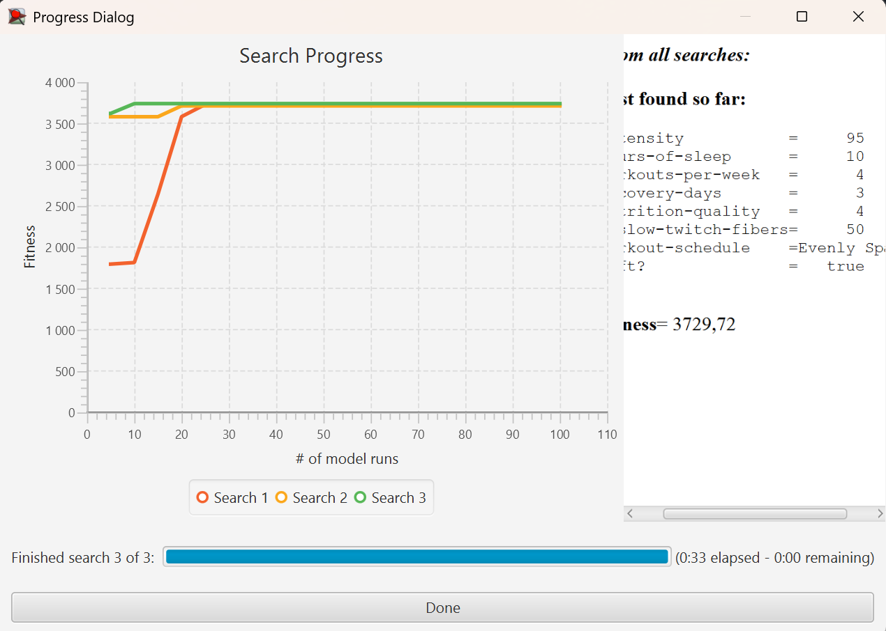
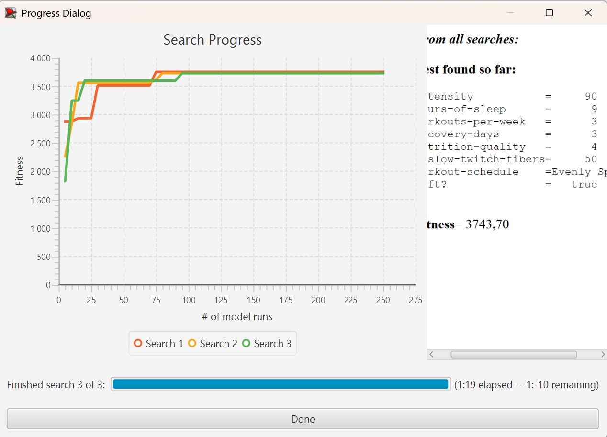

## Комп'ютерні системи імітаційного моделювання
## СПм-25-2, **Смотрова Анастасія Олександрівна**
### Лабораторна робота №**3**. Використання засобів обчислювального интелекту для оптимізації імітаційних моделей

 

### Варіант 12, модель у середовищі NetLogo:
[Muscle Development](http://www.netlogoweb.org/launch#http://www.netlogoweb.org/assets/modelslib/Sample%20Models/Biology/Muscle%20Development.nlogo)

 

#### Вербальний опис моделі:
*Модифікована імітаційна модель Muscle Development із бібліотеки середовища NetLogo призначена для дослідження зміни м'язової маси залежно від фізичних навантажень, 
тривалості сну та концентрації анаболічних і катаболічних гормонів. М'язова тканина представлена сукупністю агентів, кожен із яких відповідає окремому м'язовому волокну. 
Волокна мають індивідуальний початковий розмір і максимально допустиме значення, яке залежить від співвідношення типів м'язових волокон. 
Протягом моделювання їхній розмір змінюється відповідно до концентрації гормонів. 
Фізичні навантаження впливають на гормональне середовище, а тривалість сну визначає інтенсивність зниження концентрації гормонів. 
Загальна м'язова маса розраховується як сума розмірів усіх м'язових волокон.

#### Керуючі параметри:
- **intensity** изначає інтенсивність силових тренувань у відсотках.
- **hours-of-sleep** визначає тривалість сну протягом модельного дня.
- **workouts-per-week** визначає заплановану кількість силових тренувань протягом семи днів.
- **recovery-days** встановлює мінімальну кількість повних днів відпочинку між послідовними тренуваннями.

#### Показники роботи моделі:
- **muscle-mass** сумарний розмір усіх м'язових волокон у моделі. Показник змінюється протягом моделювання залежно від концентрації анаболічних і катаболічних гормонів, фізичних навантажень та якості харчування.
- **anabolic-hormone** концентрація анаболічних гормонів, які беруть участь у процесі збільшення розміру м'язових волокон. 
- **catabolic-hormone** концентрація катаболічних гормонів, які впливають на зменшення розміру м'язових волокон..
- **current-intensity** фактична інтенсивність останнього виконаного тренування з урахуванням можливих випадкових відхилень від початкового значення.
- **current-sleep** фактична тривалість сну протягом модельного дня, яка використовується під час розрахунку гормонального впливу.
- **current-weekly-workouts** кількість тренувань, визначена для поточного тижня до застосування обмежень мінімального відпочинку.
- **weekly-workout-days** писок днів поточного тижня, на які заплановані тренування після перевірки встановленого часу відпочинку.
- **workouts-completed** загальна кількість фактично виконаних тренувань від початку моделювання.

 

### Налаштування середовища BehaviorSearch:

**Обрана модель**:
<pre>
E:\ANASTASIIA\Универ\Магистратура\6 курс 1 семестр\КСІМ\Лаба 2\Muscle DevelopmentLab3.nlogox
</pre>
**Параметри моделі** (вкладка Model):  

<pre>
["intensity" [50 5 100]]
["hours-of-sleep" [6 1 10]]
["workouts-per-week" [1 1 7]]
["recovery-days" [0 1 3]]

["nutrition-quality" 4]
["%-slow-twitch-fibers" 50]
["workout-schedule" "Evenly Spaced"]
["lift?" true]
</pre>
  
Використовувана **міра**:  
Для цільової функції було обрано показник сумарної м'язової маси, який характеризує загальний розмір усіх м'язових волокон моделі. 
Вираз для його розрахунку взято з налаштувань графіка Muscle Development у середовищі NetLogo.
  
У вихідній моделі для побудови графіка використовується команда:
<pre>
plot muscle-mass / 100
</pre>

Ділення на 100 застосовується для масштабування значення на графіку. Для оптимізації у BehaviorSearch використовується безпосереднє значення глобальної змінної muscle-mass без масштабування.
Обраний показник вказано в полі Measure вкладки Model середовища BehaviorSearch:
<pre>
muscle-mass
</pre>

Загальний вигляд вкладки налаштувань параметрів моделі:  

Для оцінювання роботи моделі використовується значення сумарної м'язової маси наприкінці моделювання тривалістю 200 тактів.
Один такт відповідає одному модельному дню, тому обраний період охоплює 200 днів. 
На відміну від обчислення середнього значення показника протягом усієї симуляції, у цьому дослідженні оцінюється кінцева м'язова маса, оскільки метою оптимізації є досягнення її максимального значення після заданого періоду тренувань.
У полі Measure if встановлено значення true, що дозволяє виконувати вимірювання без додаткових умов. 
Параметри Setup та Step мають значення setup і go відповідно. Вони визначають процедури ініціалізації та виконання моделі, які автоматично викликаються середовищем BehaviorSearch.
Параметр Step limit встановлено на рівні 200 тактів. Умова дострокового завершення моделювання (Stop if) не використовується, тому кожна симуляція виконується протягом однакового періоду.

**Налаштування цільової функції** (вкладка Search Objective):  
Метою оптимізації імітаційної моделі Muscle Development є максимізація сумарної м'язової маси шляхом підбору значень інтенсивності тренувань, тривалості сну, кількості тренувань на тиждень та мінімального періоду відпочинку. 
Для цього у параметрі Goal встановлено значення Maximize Fitness.
Оскільки необхідно визначити максимальну м'язову масу після завершення моделювання, у параметрі Collected measure обрано AT_FINAL_STEP. 
Таким чином, для оцінювання кожної комбінації параметрів використовується значення показника muscle-mass після 200 тактів, а не його середнє значення протягом усього періоду симуляції.
Для зменшення впливу випадкових процесів, зокрема випадкового формування початкових розмірів м'язових волокон, використано режим Fixed Sampling із п'ятьма повтореннями кожної симуляції. 
У параметрі Combine replicates встановлено MEAN, тому результуюче значення цільової функції визначається як середнє арифметичне значень м'язової маси, отриманих у п'яти запусках.
Параметр Take derivatives залишено вимкненим, оскільки оптимізація проводиться за кінцевим значенням м'язової маси, а не за швидкістю її зміни. Загальний вигляд вкладки налаштувань цільової функції:  

**Налаштування алгоритму пошуку** (вкладка Search Algorithm):  
Для оптимізації параметрів моделі Muscle Development у середовищі BehaviorSearch було використано два алгоритми: випадковий пошук (RandomSearch) та генетичний алгоритм (StandardGA). 
Обидва було використано для пошуку комбінації інтенсивності тренувань, тривалості сну, кількості тренувань на тиждень і мінімального часу відпочинку, яка забезпечує максимальне значення м'язової маси після 200 тактів моделювання.
Загальний вигляд вкладки налаштувань для випадкового пошуку: 

Загальний вигляд вкладки налаштувань для генетичного алгоритму: 

StandardGA використовує популяцію можливих рішень, які змінюються в процесі роботи алгоритму за допомогою відбору, схрещування та мутації. Для дослідження було встановлено такі параметри генетичного алгоритму:

- **population-size = 20** кількість особин у популяції;
- **mutation-rate = 0.03** імовірність мутації;
- **crossover-rate = 0.8** імовірність схрещування;
- **tournament-size = 3** кількість особин, що беруть участь у турнірному відборі;
- **population-model = generational** модель формування нових поколінь.
 

### Результати використання BehaviorSearch:

Результат пошуку параметрів імітаційної моделі, використовуючи **випадковий пошук**:  

Результат пошуку параметрів імітаційної моделі, використовуючи **генетичний алгоритм**:  

